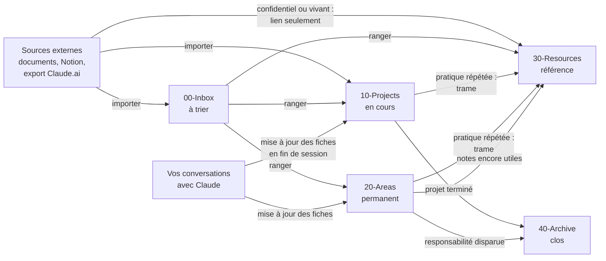
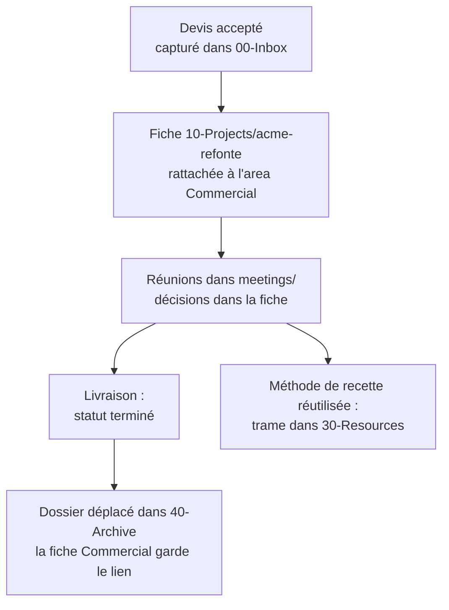
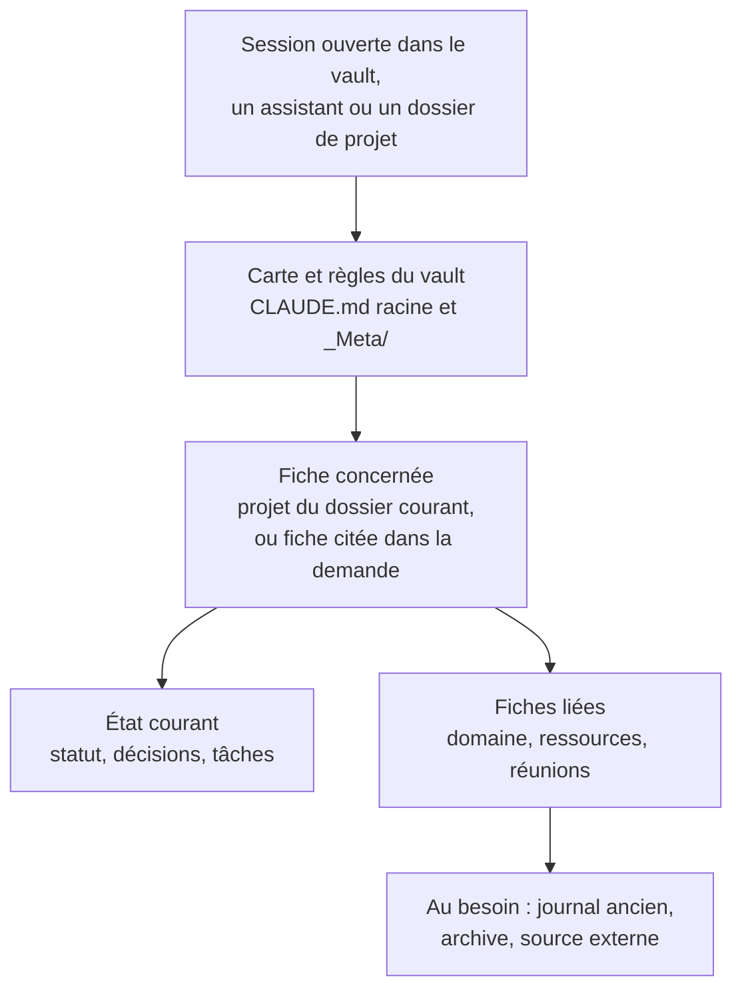

# Comprendre l'organisation du vault

Le vault range chaque information selon ce que vous devez en faire. Cette règle, issue de la méthode PARA (Projects, Areas, Resources, Archive), permet à Claude de distinguer ce qui est en cours, ce qui est permanent, ce qui sert de référence et ce qui est clos. Il charge ainsi le bon contexte sans relire tout le vault.

Cette page complète le [guide d'utilisation](../README.md). Elle est utile avant de modifier la structure du vault, ou pour comprendre pourquoi une note a été rangée à un endroit.

## Pourquoi classer par usage plutôt que par sujet

Un classement par sujet mélange des informations de nature différente. Un dossier « Finance » contiendrait à la fois la clôture annuelle en cours, le suivi permanent de la trésorerie, le modèle de prévisionnel réutilisé chaque année et les comptes de l'exercice précédent. Claude ne saurait pas lesquelles de ces notes portent un travail en cours.

Avec PARA, ces quatre informations vont à quatre endroits :

| Information | Zone | Raison |
|---|---|---|
| Clôture annuelle 2026 | `10-Projects/cloture-2026/` | Effort avec une fin et un livrable |
| Suivi de la trésorerie | `20-Areas/finance/` | Responsabilité continue, sans date de fin |
| Modèle de prévisionnel | `30-Resources/` | Référence réutilisable |
| Comptes 2025 | `40-Archive/` | Clos, conservé sans être supprimé |

La question posée à chaque rangement porte donc sur l'usage : « que dois-je en faire ? ».

## Les zones du vault

| Zone | Ce qui y vit | Ce que Claude en fait |
|---|---|---|
| `00-Inbox/` | Captures à trier, briefs du matin, brouillons de messages, tableaux d'import, rapports d'audit | Zone de passage : une note qui y reste plus de 14 jours est signalée |
| `10-Projects/` | Un dossier par projet, avec sa fiche principale et ses sous-dossiers (`meetings/`, `research/`, `journal/`) | Contexte prioritaire : le brief et la mise à jour des fiches portent d'abord sur les projets actifs |
| `20-Areas/` | Un dossier par domaine de responsabilité, avec sa fiche et ses notes de fond | Contexte permanent d'un domaine, rattaché à ses projets |
| `30-Resources/` | Trames, méthodes, références, et les renvois vers les sources externes (`references-externes/`) | Savoir réutilisable, consulté quand un projet en a besoin |
| `40-Archive/` | Projets et domaines clos, avec tout leur dossier | Hors du travail courant, mais consultable pour retrouver un précédent |
| `_Meta/` | Règles du vault : types de fiches, confidentialité, connecteurs, réglages | Lues à chaque session, elles s'appliquent à toutes les écritures |
| `_personas/` | Les assistants, chacun avec son rôle, ses zones et ses routines | Chaque assistant ne lit et n'écrit que dans les zones que lui assigne son `CLAUDE.md` |

## Le cycle de vie d'une information

Une information entre par l'Inbox ou directement dans une fiche, vit dans un projet ou un domaine, devient parfois une référence, puis rejoint l'archive. Claude effectue chaque déplacement ; ceux qui touchent plusieurs fichiers attendent votre validation.

| Mouvement | Demande ou déclencheur | Skill |
|---|---|---|
| Une source externe entre dans le vault | « importe cette note », « importe ce dossier » | `ranger` |
| Un document confidentiel ou vivant ailleurs reste à sa source | décidé à l'import | `ranger` |
| Une conversation met à jour les fiches | automatique en fin de session, ou « sync le vault » | `sync-vault` |
| Une pratique répétée devient une trame | « fais-en une trame » | `ranger` |
| Un projet terminé part en archive | « archive le projet X », ou proposé par l'audit | `structurer` |
| Un domaine disparu part en archive, ses notes utiles deviennent des références | « archive l'area X », ou proposé par l'audit | `structurer` |
| Une fiche trop lourde se déleste de son ancien journal | automatique, vers le sous-dossier `journal/` de la fiche | `sync-vault` |

## Trois exemples

### Une note de réunion

1. Après une réunion avec un client, vous collez le compte rendu : « importe cette note dans le projet Acme ».
2. Claude range le compte rendu dans `10-Projects/acme-refonte/meetings/`, daté et relié à la fiche du projet.
3. En fin de session, les décisions, les tâches et le nouveau statut passent dans la fiche `acme-refonte.md`. La réunion entre dans son journal, à sa date.
4. Le lendemain, le brief reprend les tâches dont l'échéance approche.

### Un projet client, du devis à l'archive

1. Le devis accepté arrive dans l'Inbox. « Créer le projet Acme » ouvre la fiche dans `10-Projects/acme-refonte/`, rattachée au domaine Commercial.
2. Pendant le projet, chaque session met à jour la fiche : avancement, décisions et leur raison, tâches. Depuis le dépôt de code du client, la mise à jour vise cette fiche seule.
3. À la livraison, « archive le projet Acme » vérifie les tâches restantes, déplace le dossier entier dans `40-Archive/` et marque la fiche comme terminée. La fiche du domaine Commercial garde le lien vers le projet.
4. Le projet ne pèse plus sur le brief ni sur le travail courant, mais reste consultable quand un projet semblable démarre.

### Une méthode qui devient une trame

1. Vous préparez votre troisième comité de pilotage de l'année et dites : « ça, je le refais à chaque fois, fais-en une trame ».
2. Claude retrouve les comités déjà préparés, y compris dans l'archive, et en extrait la forme commune.
3. Il vous montre la trame proposée, puis l'écrit dans `30-Resources/` après votre accord, reliée aux comités dont elle provient.
4. Quand un nouveau projet de ce type s'ouvre, Claude propose de relier sa fiche à la trame.

## Comment Claude trouve le bon contexte

Claude ne charge pas tout le vault à chaque session. Il part d'une carte, va à la fiche concernée, et n'ouvre le reste qu'au besoin.

- **Une carte lue à chaque session** : le `CLAUDE.md` à la racine du vault décrit les zones et les conventions, et les fichiers de `_Meta/` fixent les types de fiches et la confidentialité. Claude sait où chercher avant de chercher.
- **La fiche du projet retrouvée depuis votre dossier de travail** : ouverte dans le dépôt de code d'un client ou un dossier OneDrive, une session retrouve la fiche reliée à ce dossier et la prend comme contexte.
- **Des liens explicites entre fiches** : chaque fiche cite ses voisines (`[[acme-refonte]]`, `[[commercial]]`). Claude ouvre une fiche liée quand la demande le justifie, et rien d'autre.
- **Un état courant séparé de l'historique** : en tête de fiche, le statut, les décisions et les tâches ; en bas, le journal daté. Quand une fiche grossit, son ancien journal part dans `journal/`, mot pour mot : Claude lit vite l'état présent et garde l'historique à portée.
- **Des assistants cantonnés à leurs zones** : le Chief of Staff couvre l'ensemble du vault ; un assistant RH ou commercial ne travaille que dans les dossiers que lui assigne son `CLAUDE.md`. Chacun garde un contexte limité à son rôle.
- **L'archive à l'écart** : un projet clos ne figure plus dans le brief ni dans les contrôles courants, mais reste consultable pour retrouver un précédent ou rouvrir un dossier.
- **Le confidentiel jamais copié** : un document sensible reste à sa source ; le vault garde un lien et une ligne de contexte, marqués 🔒.

## Ce que vous n'avez pas à faire

Vous ne rangez rien à la main. Les demandes en langage courant suffisent, et Claude choisit la zone selon ces règles. Les déplacements qui touchent plusieurs fichiers (archiver, renommer, scinder un domaine, importer un lot) vous sont présentés avant exécution. Pour adapter la structure à votre activité, la fiche `_Meta/derivation.md` de votre vault explique pourquoi elle a cette forme et comment la faire évoluer.
